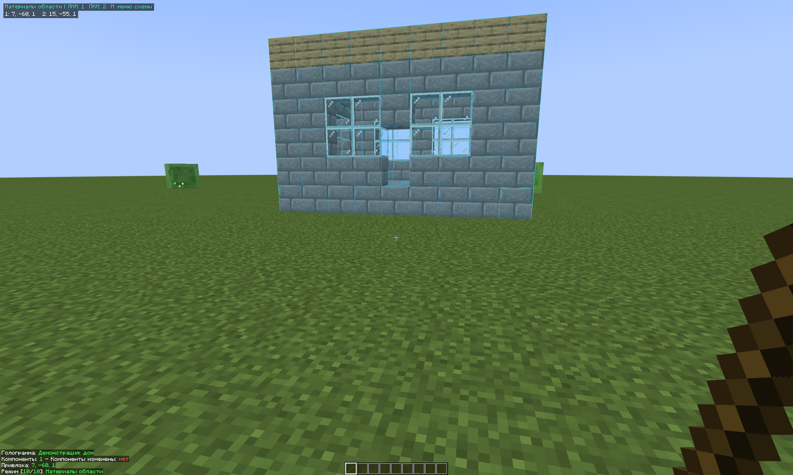
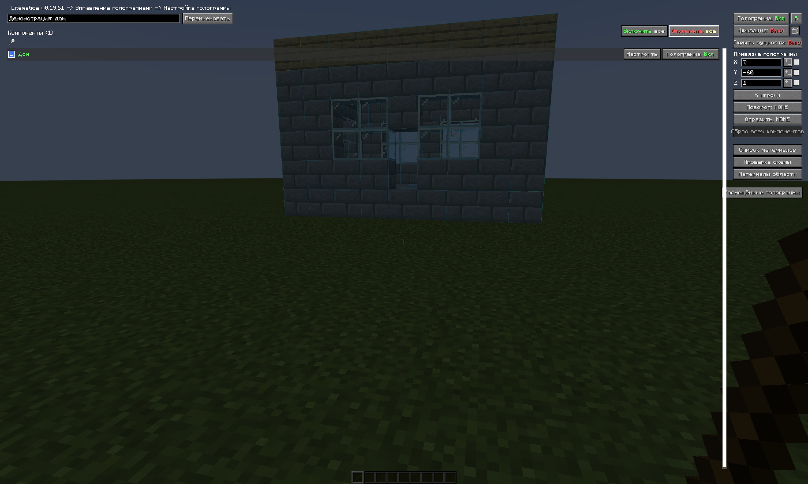

# Litematica Area Materials

Select a cuboid inside a placed schematic using Litematica tool mode **10/10** and open its native material list. **Minecraft 1.21.11 / Fabric**, client-side.

[Скачать JAR 1.2.0](https://github.com/AlexeyAndrrr/litematica-area-materials/releases/tag/v1.2.0) · [Modrinth](https://modrinth.com/mod/litematica-area-materials) · [Сообщить об ошибке](https://github.com/AlexeyAndrrr/litematica-area-materials/issues)

Клиентское дополнение для **Minecraft 1.21.11 / Fabric**. Позволяет выделить прямоугольную область внутри размещённой схемы и открыть стандартный список материалов Litematica только для этой области.

Предыдущая сборка для **Minecraft 1.21.1** доступна в [релизе 1.1.0](https://github.com/AlexeyAndrrr/litematica-area-materials/releases/tag/v1.1.0).

## Установка

В папке `mods` должны находиться:

- `litematica-area-materials-1.21.11-1.2.0.jar`;
- [Litematica 0.26.16](https://modrinth.com/mod/litematica/version/mengBR9D);
- [MaLiLib 0.27.20](https://modrinth.com/mod/malilib/version/loabWpyU).

Нужны Fabric Loader 0.20.1 или новее и Java 21 или новее. Fabric API этому дополнению не требуется. На сервер устанавливать дополнение не нужно. Версии Litematica и MaLiLib зафиксированы намеренно: дополнение встраивается в их внутренние меню и обработчики.

## Использование

1. Загрузи схему, создай её размещение и выбери его в Litematica.
2. Возьми палку — либо другой предмет, назначенный инструментом Litematica. Инструмент и отображение Litematica должны быть включены.
3. Зажми **Control (Ctrl) + прокручивай колёсико** до **«10/10 — Материалы области»**. На MacBook прокручивай двумя пальцами по трекпаду, удерживая Control ⌃. После режима №9 идёт №10, затем цикл возвращается к №1. Обратное переключение тоже работает.
4. Наведи прицел на блок схемы: **ЛКМ** устанавливает первый угол, **ПКМ** — второй. Можно выделять призрачные блоки, под которыми ещё нет построенных блоков. Углы входят в область.
5. Открой **M → Размещения схем → Настроить** у нужной схемы. Под **«Списком материалов»** и **«Проверкой схемы»** находится кнопка **«Материалы области»**.
6. Нажми её, затем **«Посмотреть список материалов»**.

Режим №10 добавлен в общий список режимов палки Litematica. Он доступен в творческом режиме и выживании. Его также можно выбрать обычным переключателем режимов инструмента в главном меню Litematica. Кнопки включения выделения в меню области больше нет: кнопка «Материалы области» используется для просмотра и управления уже выбранными углами.

Учитываются существующие назначения Litematica `operationModeChangeModifier`, `toolPlaceCorner1` и `toolPlaceCorner2`. Control + колесо и ЛКМ/ПКМ — стандартные назначения. Кнопки «Угол 1 здесь» и «Угол 2 здесь» ставят угол в координатах игрока: это удобно для пустых мест внутри схемы. СКМ меню не открывает.

Для выхода из режима прокрути **Control + колесо** до другого режима палки. Углы сохраняются до изменения размещения или выхода из мира. Режим №10 не изменяет блоки мира и не перемещает схему; модификаторы изменения обычного выделения не перемещают размещение в этом режиме.

## Что показывает список

Используется настоящее окно `GuiMaterialList` Litematica: поиск, сортировка, экспорт, множитель и HUD доступны как обычно.

- **Всего** — предметы для блоков схемы внутри выбранного объёма.
- **Не хватает** — блоки, ещё не совпадающие с миром; ошибочно поставленные блоки тоже учитываются.
- **Доступно** — предметы в инвентаре по правилам Litematica, включая поддерживаемые контейнеры.

Перевод блоков в предметы выполняет `MaterialListUtils` Litematica: это сохраняет её правила для дверей, кроватей, двойных плит, горшков и блоков с водой. Параметр Litematica `materialListIgnoreState` учитывается при сравнении с миром.

Считается выбранная схема, даже если поверх неё размещена другая. Учитываются только включённые части выбранного размещения. Область пересекается с их границами и высотой мира. Слои отображения помогают навести прицел на нужный блок, но список охватывает весь выделенный объём.

Подсчёт идёт порциями с ограничением времени. Если нужный чанк не загружен, появятся его координаты: подойди ближе, и подсчёт продолжится. После изменения мира нажми «Обновить» в списке.

## Ограничения

- Одно прямоугольное выделение на размещение; выделения не записываются на диск.
- При переносе, повороте, отражении или изменении включённых частей размещения углы сбрасываются.
- Если части *одной* схемы перекрывают друг друга, каждая позиция считается один раз. При конфликте непустых блоков приоритет имеет часть с более поздним именем в алфавитном порядке; воздух и `structure_void` пропускаются. Это может отличаться от отображения таких неоднозначных схем в Litematica.
- Полный список появляется после завершения подсчёта; загрузка всех затронутых чанков обязательна для сравнения с миром.

## Сборка

Установи JDK 21 и выполни:

```sh
./gradlew build
```

Windows:

```bat
gradlew.bat build
```

Результат: `build/libs/litematica-area-materials-1.21.11-1.2.0.jar`. Не устанавливай `-sources.jar` как мод.

Тесты запускаются командой `./gradlew test` через Fabric Loader JUnit. Они проверяют включённые границы, пересечения и исключение повторного подсчёта, сочетания поворотов и отражений, отрицательные размеры частей, обрезку по высоте мира применение mixin-вставок к классам Litematica, десятый режим в общем списке, циклическое переключение в обе стороны и доступность в выживании.

## Статус сборки 1.2.0

Порт для Minecraft 1.21.11 с Litematica 0.26.16 и MaLiLib 0.27.20. По просьбе владельца автоматические тесты и запуск игры для этой версии не выполнялись. Выпуск отмечен как предварительный. Тесты предыдущей версии в репозитории сохранены.

## Исходные проекты

Дополнение независимо от Litematica; зависимости в JAR не включены.

- [Litematica — код ветки 1.21](https://github.com/sakura-ryoko/litematica/tree/LTS/1.21), masa и Sakura-Ryoko.
- [MaLiLib — код ветки 1.21](https://github.com/sakura-ryoko/malilib/tree/LTS/1.21).
- [Fabric Loader JUnit](https://docs.fabricmc.net/develop/automatic-testing).

Собственный код дополнения распространяется под MIT, см. `LICENSE`.

## Скриншоты

Снимки ниже сделаны в предыдущей версии **1.1.0 для Minecraft 1.21.1** и показывают назначение интерфейса. Новые снимки и игровая проверка версии 1.2.0 не выполнялись.

Режим палки №10 и выделение стены:



Кнопка в настройках размещённой схемы:



[Меню двух углов](docs/screenshots/03-area-corners-menu.png) · [Список материалов выбранной стены](docs/screenshots/04-selected-wall-materials.png)

## Использование ИИ

Код дополнения, тесты, переводы и текст страницы преимущественно созданы с помощью OpenAI Codex по требованиям владельца проекта. Скриншоты сделаны в настоящем Minecraft 1.21.1 с установленным JAR 1.1.0; версия 1.2.0 в игре не проверялась. Сгенерированные ИИ изображения не используются.
